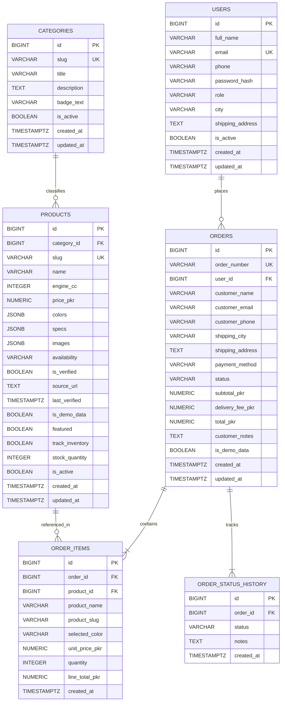

# Honda Bikes Store — Database Schema & Architecture

Unofficial Honda motorcycle e-commerce website for Pakistan.  
This document outlines the complete relational database architecture.

> [!NOTE]  
> **Testing Status:** **VERIFIED ON LIVE LOCAL XAMPP MYSQL (PORT 3306)**.  
> The backend connects to MySQL 8.0+ / MariaDB via `mysql2/promise` with full table schema (`database/schema.mysql.sql`), foreign keys, `is_active` flags, and verified seed data. Reference PostgreSQL DDL is also maintained in `database/schema.sql`.

---

## 1. Entity-Relationship Diagram (ERD)

---

## 2. Table Specifications

### 2.1 `categories`
Segments motorcycles into market categories (Commuter, Standard, Sport & Touring).

| Column | Type | Constraints | Description |
|---|---|---|---|
| `id` | `BIGINT` | `PRIMARY KEY GENERATED ALWAYS AS IDENTITY` | Internal surrogate identifier |
| `slug` | `VARCHAR(50)` | `NOT NULL UNIQUE` | URL-friendly segment slug (`commuter`, `standard`, `sport`) |
| `title` | `VARCHAR(100)` | `NOT NULL` | Human-readable title |
| `description` | `TEXT` | `NULL` | Category overview |
| `badge_text` | `VARCHAR(50)` | `NULL` | UI marketing pill (e.g. "High Efficiency") |
| `created_at` | `TIMESTAMPTZ` | `NOT NULL DEFAULT now()` | Row creation timestamp |
| `updated_at` | `TIMESTAMPTZ` | `NOT NULL DEFAULT now()` | Row modification timestamp |

---

### 2.2 `products`
Catalog of motorcycle models. Aligns directly with [`frontend/src/data/bikes.js`](file:///c:/Users/Hp/Desktop/Ecommerce/frontend/src/data/bikes.js).

| Column | Type | Constraints | Description |
|---|---|---|---|
| `id` | `BIGINT` | `PRIMARY KEY GENERATED ALWAYS AS IDENTITY` | Internal surrogate identifier |
| `category_id` | `BIGINT` | `NOT NULL REFERENCES categories(id) ON DELETE RESTRICT` | Associated category |
| `slug` | `VARCHAR(100)` | `NOT NULL UNIQUE` | Matches frontend IDs (e.g. `honda-cd-70`, `honda-cg-125`) |
| `name` | `VARCHAR(150)` | `NOT NULL` | Display model name |
| `engine_cc` | `INTEGER` | `CHECK (engine_cc IS NULL OR engine_cc > 0)` | Engine displacement in cc (NULL if unverified) |
| `price_pkr` | `NUMERIC(12,2)` | `CHECK (price_pkr IS NULL OR price_pkr >= 0)` | Official price in PKR (NULL if unverified) |
| `colors` | `JSONB` | `NOT NULL DEFAULT '[]'::jsonb` | Available color options array |
| `specs` | `JSONB` | `NOT NULL DEFAULT '{}'::jsonb` | Unverified or verified technical spec key-value pairs |
| `images` | `JSONB` | `NOT NULL DEFAULT '[]'::jsonb` | Product image paths array |
| `availability` | `VARCHAR(30)` | `NOT NULL DEFAULT 'unknown' CHECK (availability IN ('in_stock', 'out_of_stock', 'coming_soon', 'unknown'))` | Stock availability status |
| `is_verified` | `BOOLEAN` | `NOT NULL DEFAULT false` | Data verification flag |
| `source_url` | `TEXT` | `NULL` | Official source link if verified |
| `last_verified` | `TIMESTAMPTZ` | `NULL` | Timestamp of latest manual data verification |
| `is_demo_data` | `BOOLEAN` | `NOT NULL DEFAULT true` | Flag denoting placeholder/unverified status |
| `featured` | `BOOLEAN` | `NOT NULL DEFAULT false` | Shown on homepage featured section |
| `track_inventory` | `BOOLEAN` | `NOT NULL DEFAULT false` | If false, stock quantity is ignored for unverified demo items |
| `stock_quantity` | `INTEGER` | `NOT NULL DEFAULT 0 CHECK (stock_quantity >= 0)` | Physical warehouse stock |
| `created_at` | `TIMESTAMPTZ` | `NOT NULL DEFAULT now()` | Row creation timestamp |
| `updated_at` | `TIMESTAMPTZ` | `NOT NULL DEFAULT now()` | Row modification timestamp |

---

### 2.3 `users`
Customer and staff accounts.

| Column | Type | Constraints | Description |
|---|---|---|---|
| `id` | `BIGINT` | `PRIMARY KEY GENERATED ALWAYS AS IDENTITY` | Internal surrogate identifier |
| `full_name` | `VARCHAR(150)` | `NOT NULL` | Customer full name |
| `email` | `VARCHAR(255)` | `NOT NULL UNIQUE CHECK (email ~* '^[A-Za-z0-9._%+-]+@[A-Za-z0-9.-]+\.[A-Za-z]{2,}$')` | Lowercase sanitized email |
| `phone` | `VARCHAR(20)` | `NOT NULL CHECK (phone ~ '^03[0-9]{9}$')` | Standard 11-digit Pakistani mobile number |
| `password_hash` | `VARCHAR(255)` | `NOT NULL` | Argon2id or bcrypt hash (no plain text passwords) |
| `role` | `VARCHAR(20)` | `NOT NULL DEFAULT 'customer' CHECK (role IN ('customer', 'admin', 'staff'))` | User permission role |
| `city` | `VARCHAR(100)` | `NULL` | Default city (e.g. Lahore, Karachi) |
| `shipping_address` | `TEXT` | `NULL` | Default delivery address |
| `is_active` | `BOOLEAN` | `NOT NULL DEFAULT true` | Account active flag |
| `created_at` | `TIMESTAMPTZ` | `NOT NULL DEFAULT now()` | Registration timestamp |
| `updated_at` | `TIMESTAMPTZ` | `NOT NULL DEFAULT now()` | Profile update timestamp |

---

### 2.4 `orders`
Customer bike booking requests and orders.

| Column | Type | Constraints | Description |
|---|---|---|---|
| `id` | `BIGINT` | `PRIMARY KEY GENERATED ALWAYS AS IDENTITY` | Internal surrogate identifier |
| `order_number` | `VARCHAR(50)` | `NOT NULL UNIQUE` | Public booking reference (e.g. `PK-20261029-ABCD`) |
| `user_id` | `BIGINT` | `REFERENCES users(id) ON DELETE SET NULL` | Linked registered user (or NULL for guest checkout) |
| `customer_name` | `VARCHAR(150)` | `NOT NULL` | Name on delivery booking |
| `customer_email` | `VARCHAR(255)` | `NOT NULL CHECK (customer_email ~* '^[A-Za-z0-9._%+-]+@[A-Za-z0-9.-]+\.[A-Za-z]{2,}$')` | Email for notifications |
| `customer_phone` | `VARCHAR(20)` | `NOT NULL CHECK (customer_phone ~ '^03[0-9]{9}$')` | 11-digit Pakistani phone |
| `shipping_city` | `VARCHAR(100)` | `NOT NULL` | Delivery city |
| `shipping_address` | `TEXT` | `NOT NULL` | Full street address |
| `payment_method` | `VARCHAR(50)` | `NOT NULL DEFAULT 'cod' CHECK (payment_method IN ('cod', 'bank_transfer'))` | Payment mode (COD default) |
| `status` | `VARCHAR(30)` | `NOT NULL DEFAULT 'pending' CHECK (status IN ('pending', 'confirmed', 'dispatched', 'delivered', 'cancelled'))` | Lifecycle state matching Phase 7 |
| `subtotal_pkr` | `NUMERIC(12,2)` | `CHECK (subtotal_pkr IS NULL OR subtotal_pkr >= 0)` | Sum of items (NULL if prices unverified) |
| `delivery_fee_pkr`| `NUMERIC(12,2)` | `NOT NULL DEFAULT 0.00 CHECK (delivery_fee_pkr >= 0)` | Shipping charge |
| `total_pkr` | `NUMERIC(12,2)` | `CHECK (total_pkr IS NULL OR total_pkr >= 0)` | Final payable PKR |
| `customer_notes` | `TEXT` | `NULL` | Optional instructions from customer |
| `is_demo_data` | `BOOLEAN` | `NOT NULL DEFAULT false` | Flag if created for test/demo purposes |
| `created_at` | `TIMESTAMPTZ` | `NOT NULL DEFAULT now()` | Order timestamp |
| `updated_at` | `TIMESTAMPTZ` | `NOT NULL DEFAULT now()` | Last update timestamp |

---

### 2.5 `order_items`
Individual motorcycles included in an order.

| Column | Type | Constraints | Description |
|---|---|---|---|
| `id` | `BIGINT` | `PRIMARY KEY GENERATED ALWAYS AS IDENTITY` | Item identifier |
| `order_id` | `BIGINT` | `NOT NULL REFERENCES orders(id) ON DELETE CASCADE` | Associated order |
| `product_id` | `BIGINT` | `REFERENCES products(id) ON DELETE RESTRICT` | Referenced bike model |
| `product_name` | `VARCHAR(150)` | `NOT NULL` | Historical name snapshot at purchase |
| `product_slug` | `VARCHAR(100)` | `NOT NULL` | Slug snapshot |
| `selected_color`| `VARCHAR(50)` | `NULL` | Chosen color variant |
| `unit_price_pkr`| `NUMERIC(12,2)` | `CHECK (unit_price_pkr IS NULL OR unit_price_pkr >= 0)` | Historical unit price snapshot |
| `quantity` | `INTEGER` | `NOT NULL DEFAULT 1 CHECK (quantity > 0)` | Number of bikes booked |
| `line_total_pkr`| `NUMERIC(12,2)` | `CHECK (line_total_pkr IS NULL OR line_total_pkr >= 0)` | Calculated `unit_price_pkr * quantity` |
| `created_at` | `TIMESTAMPTZ` | `NOT NULL DEFAULT now()` | Creation timestamp |

---

### 2.6 `order_status_history`
Audit log tracking every status transition of an order.

| Column | Type | Constraints | Description |
|---|---|---|---|
| `id` | `BIGINT` | `PRIMARY KEY GENERATED ALWAYS AS IDENTITY` | Audit log identifier |
| `order_id` | `BIGINT` | `NOT NULL REFERENCES orders(id) ON DELETE CASCADE` | Associated order |
| `status` | `VARCHAR(30)` | `NOT NULL CHECK (status IN ('pending', 'confirmed', 'dispatched', 'delivered', 'cancelled'))` | New status |
| `notes` | `TEXT` | `NULL` | Reason / note (e.g. "Customer verified via phone call") |
| `created_at` | `TIMESTAMPTZ` | `NOT NULL DEFAULT now()` | Transition timestamp |

---

## 3. Design Decisions & Rationale

1. **`BIGINT GENERATED ALWAYS AS IDENTITY` for Primary Keys:**
   - Follows PostgreSQL standard recommendation over legacy `SERIAL`. Identity columns prevent accidental manual overrides and offer maximum scalability.
2. **`NUMERIC(12,2)` for Currency:**
   - Floating-point types (`REAL`, `DOUBLE PRECISION`) suffer from IEEE-754 rounding errors. `NUMERIC` guarantees exact decimal precision required for monetary figures.
3. **`TIMESTAMPTZ` with `set_updated_at()` Trigger:**
   - Always stores timestamps in UTC with timezone awareness. The reusable `set_updated_at()` trigger ensures `updated_at` is automatically updated on every SQL `UPDATE` statement without relying on application code.
4. **Historical Snapshotting in `order_items`:**
   - Product names, slugs, and unit prices are copied directly into `order_items`. If a bike's catalog price or name changes in the future, past orders remain legally accurate and unmodified.
5. **Data Integrity & Zero Fabrication Policy:**
   - Unverified prices and specs are strictly stored as `NULL` with `is_demo_data = true` and `is_verified = false`. `track_inventory = false` prevents artificial inventory decrements on unverified items.
6. **Pakistani Phone Validation Check:**
   - Enforces `phone ~ '^03[0-9]{9}$'`, matching the UI validation rule in [`frontend/src/utils/checkoutValidation.js`](file:///c:/Users/Hp/Desktop/Ecommerce/frontend/src/utils/checkoutValidation.js).

